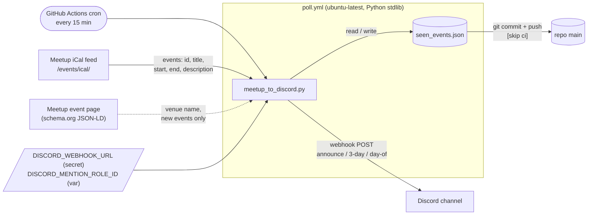
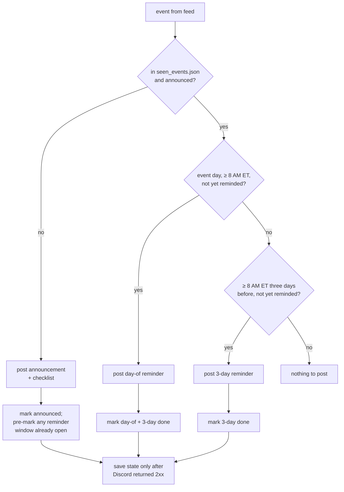
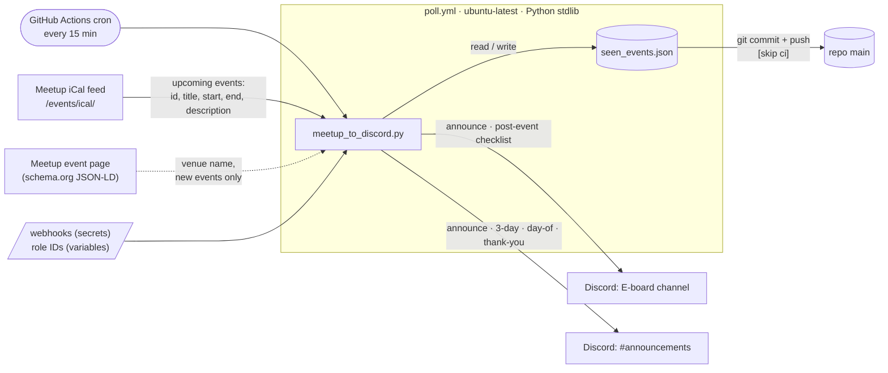
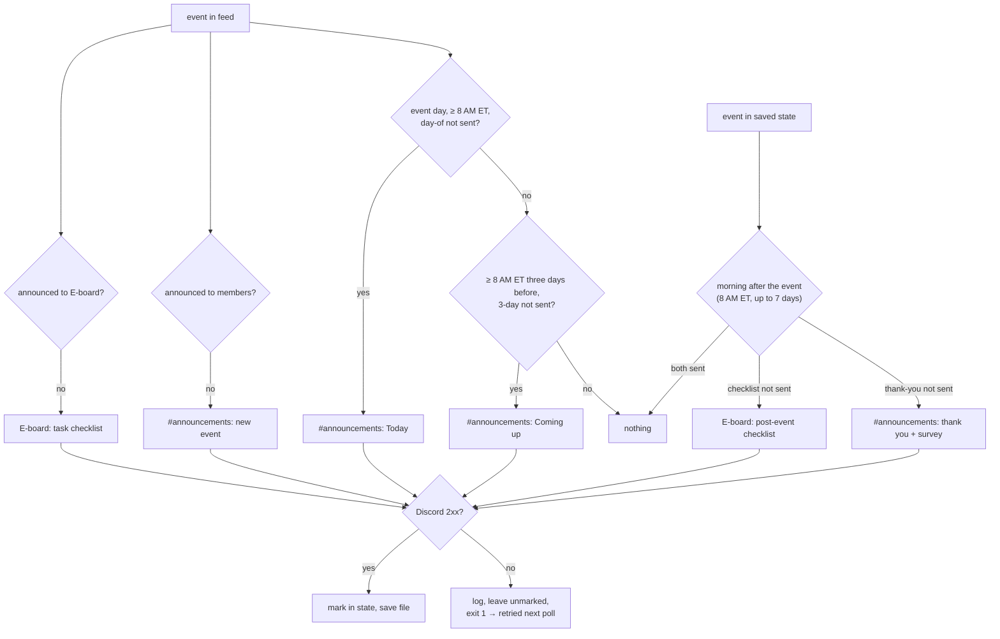

# meetup-to-discord

When a new event is published to the [AWS SBG @ FIU Meetup group](https://www.meetup.com/aws-sbg-at-florida-international-university/),
post to two Discord channels:

| When | E-board channel | `#announcements` (members) |
|---|---|---|
| Event published | task checklist post | announcement with date, time, room, blurb, RSVP link |
| 8 AM ET, 3 days before | | "Coming up Thursday" reminder |
| 8 AM ET, day of | | "Today" reminder |
| 8 AM ET, day after | post-event checklist (photos, slides, recap) | thank-you with the feedback survey link |

Each channel has its own webhook and its own role to @mention.

- **Runs on GitHub Actions** every 15 minutes. No servers, no AWS.
- **Python 3.11+, standard library only.** One file: `meetup_to_discord.py`.
- **Source:** the group's public iCal feed (`/events/ical/`). It carries the event ID, start and
  end times in America/New_York, and the description. The RSS feed has none of the times.
- **State:** `seen_events.json`, committed back to this repo by the workflow.
- **Safe:** an event is only marked as posted after Discord returns 2xx. Feed or webhook
  failures exit non-zero and are retried on the next poll.

## How it works



Each run is one decision per event:



If Discord or the feed fails, nothing is marked and the run exits non-zero; the next poll
retries. Entries for events gone from the feed are pruned 90 days after they started.

## How it works



Each run makes one decision per event per audience. Upcoming events come from the feed; the
morning-after posts come from saved state, because Meetup drops an event from the feed once it
is over.



Entries for events gone from the feed are pruned 90 days after they started.

## Setup (one time)

1. **Create the Discord webhook.** In Discord: the target channel → Edit Channel → Integrations
   → Webhooks → New Webhook. Name it (for example "Meetup"), pick the channel, Copy Webhook URL.
2. **Store it as a repo secret:**
   ```sh
   gh secret set DISCORD_WEBHOOK_URL -R wakeensito/meetup-to-discord
   # paste the URL when prompted
   ```
3. **Seed the state** so old events are not re-announced. Either commit a seeded file locally
   (`python3 meetup_to_discord.py --seed`, then commit `seen_events.json`), or run the
   "Poll Meetup" workflow once from the Actions tab with the **seed** box checked.
4. **Members channel.** Create a second webhook in `#announcements` and store it:
   ```sh
   gh secret set DISCORD_ANNOUNCE_WEBHOOK_URL -R wakeensito/meetup-to-discord
   ```
   Without it the bot still runs; member posts are skipped with a warning and sent once it is set.
5. **Role pings.** Get a role ID in Discord by typing `\@RoleName` in any channel (it posts as
   `<@&123…>`), or Server Settings → Roles → ⋯ → Copy Role ID with Developer Mode on. Store them
   as repo variables:
   ```sh
   gh variable set DISCORD_MENTION_ROLE_ID  -R wakeensito/meetup-to-discord --body "<E-board role id>"
   gh variable set DISCORD_ANNOUNCE_ROLE_ID -R wakeensito/meetup-to-discord --body "<members role id>"
   ```
   Each post can ping only its own role; `@everyone`, `@here` and user mentions in event text
   stay disabled.
6. Done. The schedule is already on. Run the workflow manually from the Actions tab
   (**Run workflow**) any time to test.

## Run locally

```sh
export DISCORD_WEBHOOK_URL='https://discord.com/api/webhooks/...'   # not needed for --dry-run

python3 meetup_to_discord.py --dry-run                 # show what would be posted, change nothing
python3 meetup_to_discord.py --seed                    # record every current event, post nothing
python3 meetup_to_discord.py                           # real poll: post + update seen_events.json
python3 meetup_to_discord.py --dry-run --now 2026-10-19T10:00   # preview the 3-day reminder
python3 meetup_to_discord.py --dry-run --now 2026-10-22T08:05   # preview the day-of reminder
python3 meetup_to_discord.py --dry-run --now 2026-10-23T08:05   # preview the morning-after posts

# No upcoming events on Meetup? Use the saved feed to preview every message type:
python3 meetup_to_discord.py --dry-run --feed tests/fixtures/events.ics --state /tmp/s.json --now 2026-10-17T12:00
```

Options: `--state PATH` (default `seen_events.json`), `--group SLUG` or env `MEETUP_GROUP`
(default `aws-sbg-at-florida-international-university`), `--mention-role ID` or env
`DISCORD_MENTION_ROLE_ID`, `--announce-role ID` or env `DISCORD_ANNOUNCE_ROLE_ID`, `--feed URL|FILE`.

Tests: `python3 -m unittest discover -s tests`

## How reminders work

Each event in `seen_events.json` carries one flag per post:

```json
"316843450": {
  "title": "AWS Certifications & Career Success Workshop",
  "start": "2026-10-22T15:00:00-04:00",
  "url": "https://www.meetup.com/aws-sbg-at-florida-international-university/events/316843450/",
  "survey_url": "https://forms.gle/…",
  "announced": true,
  "member_announced": true,
  "reminded_3d": false,
  "reminded_day_of": false,
  "posted_recap": false,
  "member_thanked": false
}
```

`announced` and `posted_recap` are the E-board posts; the rest go to `#announcements`.

- **3-day reminder** posts on the first poll at or after 8:00 AM ET three days before the event day.
- **Day-of reminder** posts on the first poll at or after 8:00 AM ET on the event day (midnight
  if the event starts before 8). If the 3-day reminder was missed, only the day-of one posts.
- **Morning after** at 8:00 AM ET: the E-board gets the post-event checklist (photos, slides,
  recap, LinkedIn, Instagram) and members get a thank-you with the feedback survey. Both work
  from saved state, since the event has left the feed by then. If the bot was down, they still
  post up to 7 days after the event, then give up.
- **Survey link.** If the Meetup description contains a Google Forms, Microsoft Forms, Typeform,
  SurveyMonkey, Qualtrics, Airtable, Tally or Jotform link, the thank-you links it directly. Add
  it to the description any time before the morning after; the bot re-reads it every poll.
  Otherwise the thank-you points members to the Meetup event page.
- **Member blurb.** The announcement quotes the first paragraph of the Meetup description
  (bold stripped, about 300 characters). Keep the opening paragraph punchy.
- An event announced inside a window does not also get that window's reminder on the same run.
- Seeded events are never re-announced to either audience, but still get the reminders, the
  checklist and the thank-you. To skip any post for one event, set its flag to `true` and commit.

## Reset or re-post

- **Re-post one event:** delete its key from `seen_events.json`, commit, push. The next poll
  announces it again.
- **Reset everything:** delete `seen_events.json`, run `python3 meetup_to_discord.py --seed`,
  commit the new file.
- **Change the message:** edit `CHECKLIST` / `format_announcement` in `meetup_to_discord.py`,
  update the test, check with `--dry-run`.

## Operational notes

- **Main is not branch-protected on purpose.** The workflow pushes `seen_events.json` to main
  with the built-in Actions token, which cannot bypass protection. If protection is ever wanted,
  move the state file to a separate unprotected `state` branch and check that out in `poll.yml`.
- **60-day rule.** GitHub disables scheduled workflows after 60 days without repo activity. The
  bot writes a weekly `_last_checked` heartbeat into the state file to stay active. If the
  Actions tab ever shows the schedule disabled, click **Enable workflow**.
- **Location line.** The venue name comes from the event page's schema.org metadata and the room
  from a `Room: ...` line in the Meetup description. Put `Room: INV1 - 201` in the description
  and it shows up as `📍 Florida International University (Modesto main campus) · Room: INV1 - 201`.
  If neither is available the line is omitted.
- **Mentions are locked down.** `allowed_mentions` is `{parse: []}` plus the one role for that
  channel, so an event title containing `@everyone` cannot ping the server.
