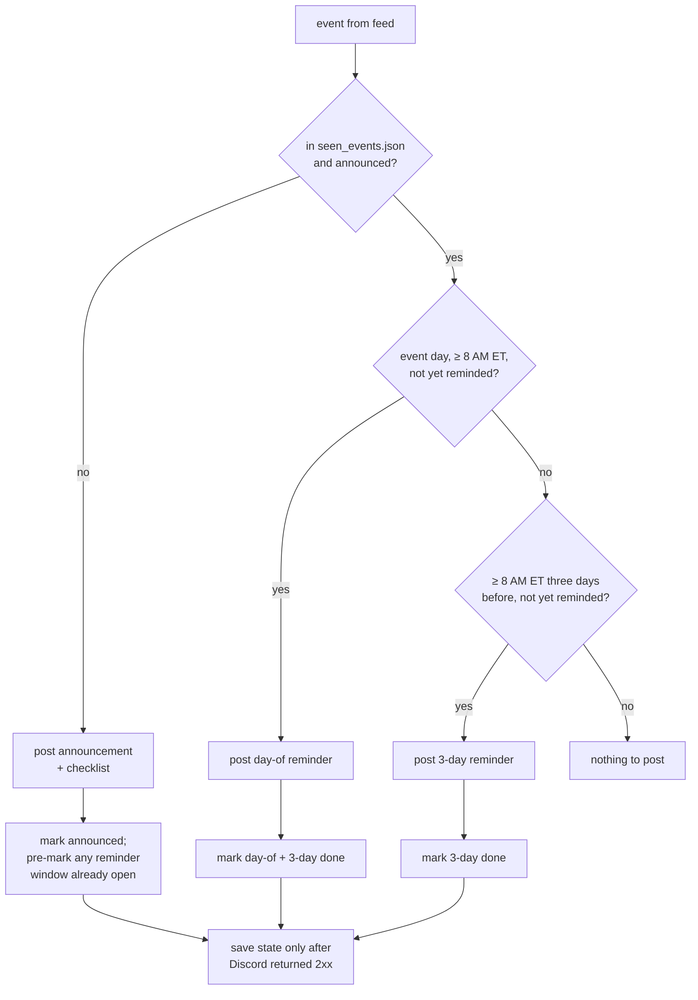

# meetup-to-discord

When a new event is published to the [AWS SBG @ FIU Meetup group](https://www.meetup.com/aws-sbg-at-florida-international-university/),
post one Discord message with the event details and the team task checklist. Then post a
short reminder 3 days before and on the morning of the event.

- **Runs on GitHub Actions** every 15 minutes. No servers, no AWS.
- **Python 3.11+, standard library only.** One file: `meetup_to_discord.py`.
- **Source:** the group's public iCal feed (`/events/ical/`). It carries the event ID, start and
  end times in America/New_York, and the description. The RSS feed has none of the times.
- **State:** `seen_events.json`, committed back to this repo by the workflow.
- **Safe:** an event is only marked as posted after Discord returns 2xx. Feed or webhook
  failures exit non-zero and are retried on the next poll.

## How it works


Each run is one decision per event:



If Discord or the feed fails, nothing is marked and the run exits non-zero; the next poll
retries. Entries for events gone from the feed are pruned 90 days after they started.

## Setup (one time)

1. **Create the Discord webhook.** In Discord: the target channel → Edit Channel → Integrations
   → Webhooks → New Webhook. Name it (for example "Meetup"), pick the channel, Copy Webhook URL.
2. **Store it as a repo secret:**
   ```sh
   gh secret set DISCORD_WEBHOOK_URL -R wakeensito/meetup-to-discord
   # paste the URL when prompted
   ```
3. **Seed the state** so old events are not re-announced. Either commit a seeded file locally
   (`python3 meetup_to_discord.py --seed`, then commit `seen_events.json`), or run the
   "Poll Meetup" workflow once from the Actions tab with the **seed** box checked.
4. **Optional: @mention a role** (for example the E-board role) at the end of every post. Get
   the role ID in Discord (Settings → Advanced → Developer Mode on, then Server Settings →
   Roles → ⋯ → Copy Role ID) and store it as a repo variable:
   ```sh
   gh variable set DISCORD_MENTION_ROLE_ID -R wakeensito/meetup-to-discord --body "123456789012345678"
   ```
   Only that one role can be pinged; `@everyone`, `@here` and user mentions in event text stay
   disabled.
5. Done. The schedule is already on. Run the workflow manually from the Actions tab
   (**Run workflow**) any time to test.

## Run locally

```sh
export DISCORD_WEBHOOK_URL='https://discord.com/api/webhooks/...'   # not needed for --dry-run

python3 meetup_to_discord.py --dry-run                 # show what would be posted, change nothing
python3 meetup_to_discord.py --seed                    # record every current event, post nothing
python3 meetup_to_discord.py                           # real poll: post + update seen_events.json
python3 meetup_to_discord.py --dry-run --now 2026-10-19T10:00   # preview the 3-day reminder
python3 meetup_to_discord.py --dry-run --now 2026-10-22T08:05   # preview the day-of reminder
```

Options: `--state PATH` (default `seen_events.json`), `--group SLUG` or env `MEETUP_GROUP`
(default `aws-sbg-at-florida-international-university`), `--mention-role ID` or env
`DISCORD_MENTION_ROLE_ID`.

Tests: `python3 -m unittest discover -s tests`

## How reminders work

Each event in `seen_events.json` carries three flags:

```json
"316843450": {
  "title": "AWS Certifications & Career Success Workshop",
  "start": "2026-10-22T15:00:00-04:00",
  "announced": true,
  "reminded_3d": false,
  "reminded_day_of": false
}
```

- **3-day reminder** posts on the first poll at or after 8:00 AM ET three days before the event day.
- **Day-of reminder** posts on the first poll at or after 8:00 AM ET on the event day (midnight
  if the event starts before 8). If the 3-day reminder was missed, only the day-of one posts.
- An event announced inside a window does not also get that window's reminder on the same run.
- Seeded events still get reminders. To skip them for one event, set its two `reminded_*`
  flags to `true` and commit.

## Reset or re-post

- **Re-post one event:** delete its key from `seen_events.json`, commit, push. The next poll
  announces it again.
- **Reset everything:** delete `seen_events.json`, run `python3 meetup_to_discord.py --seed`,
  commit the new file.
- **Change the message:** edit `CHECKLIST` / `format_announcement` in `meetup_to_discord.py`,
  update the test, check with `--dry-run`.

## Operational notes

- **Main is not branch-protected on purpose.** The workflow pushes `seen_events.json` to main
  with the built-in Actions token, which cannot bypass protection. If protection is ever wanted,
  move the state file to a separate unprotected `state` branch and check that out in `poll.yml`.
- **60-day rule.** GitHub disables scheduled workflows after 60 days without repo activity. The
  bot writes a weekly `_last_checked` heartbeat into the state file to stay active. If the
  Actions tab ever shows the schedule disabled, click **Enable workflow**.
- **Location line.** The venue name comes from the event page's schema.org metadata and the room
  from a `Room: ...` line in the Meetup description. Put `Room: INV1 - 201` in the description
  and it shows up as `📍 Florida International University (Modesto main campus) · Room: INV1 - 201`.
  If neither is available the line is omitted.
- **Mentions are locked down.** `allowed_mentions` is `{parse: []}` plus the one role from
  `DISCORD_MENTION_ROLE_ID`, so an event title containing `@everyone` cannot ping the server.
